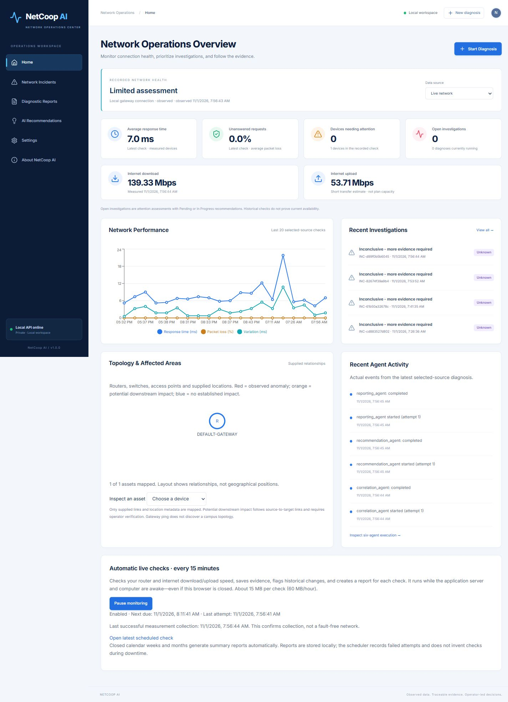

# NetCoop AI

## Network Operations Center workspace

The existing app is now organized into six primary sections: **Home**, **Network Incidents**, **Diagnostic Reports**, **AI Recommendations**, **Settings**, and **About NetCoop AI**. See `docs/FEATURE_MAP.md` for the feature-to-page mapping.

- Diagnosis inputs live at `/incidents/new?mode=upload`, `?mode=live`, or `?mode=demo`. Existing `/start` links still resolve to the diagnosis workspace.
- Incident details have eight separate tabs: Overview, Agent Execution, Root Cause Analysis, Topology and Impact, Evidence Register, Recommendations, Execution Timeline, and Related Reports. Their tab selection is included in the URL.
- Recommendation detail pages add investigation status, evidence, linked fresh tests, operator activity history, and completion verification. Completing an action through the status API now requires `operator_confirmed: true` and a non-empty `verification_note`. Confirmation changes tracking only; it does not execute a network repair. Older report snapshots remain immutable.
- Report search, type/status filters, pagination, origin links and all existing exports remain available. Weekly/monthly reports link to their individual recorded checks.
- Settings groups the existing diagnostic controls into ten sections. Browser-only workspace label/density/date/report-action preferences are explicitly separate from persisted backend diagnostic settings. Notifications and unimplemented connectors remain labelled unavailable. A workspace JSON backup can be downloaded without deleting data.
- About reads actual database/API health and a timestamped test-run record. It does not fabricate a team or published GitHub repository. Set `NETCOOP_GITHUB_URL` to a repository URL if one is published later.
- Monitoring state, the 300-second interval, SQLite record-table schema, existing incidents/reports and original API routes are preserved. Home uses recorded source-selected measurements; open-investigation counts are attention assessments with Pending/In Progress recommendations, not a fabricated incident-resolution state.

Run the new UI workflow checks with `npm --prefix frontend test`; backend checks remain `python -m pytest backend/tests -q`. `scripts/record_test_status.py` records the saved Pytest JUnit and Vitest JSON outputs for the About page.

## New topology, explanations and monitoring

### Root cause dependency graphs

New incident reports now contain a canonical dependency graph: assessment, devices, supplied links, departments/hostels/segments, reported services and advisory next steps. Optional device `services` values name services actually hosted on that device. The **Router failure dependency chain** and **Campus segment outage** demos illustrate downstream impact. Red nodes carry observed fault evidence; orange nodes show potential impact requiring verification. Arrows are labelled relationships, not proof of causality.

The same graph appears in Incident Details, report preview, PDF vector diagrams, DOCX embedded images and JSON. Large graphs are paginated without discarding nodes; complete labels, cross-diagram arrows and evidence IDs remain in the report register. Newly generated weekly/monthly reports include a graph for each saved live check. Existing report snapshots are preserved; generate an updated report to add a graph to an older incident.

- Add optional device fields `location`, `hostel`, `department`, and `segment_id` to uploaded telemetry. Incident Topology maps supplied links and highlights observed anomalies in red and potential downstream impact in orange. The **Campus segment outage** demo illustrates these groupings. Live ICMP checks discover only the current gateway, not campus switches or physical topology.
- Incident Details shows the measurements, detecting agents, evidence IDs, confidence method, uncertainty reasons, ranked alternatives and competing-cause resolution. Close candidate scores (difference below 0.08) remain inconclusive; a ranking never proves causality. These are deterministic agent comparisons, not simulated agent conversations.
- Performance and Infrastructure agents compare metrics with the median of up to 20 comparable prior observations within 30 days. At least five distinct earlier timestamps are required. Alert threshold is median + max(absolute minimum change, 50% of median, 3 × 1.4826 × median absolute deviation). Absolute minimum changes: 20 ms latency, 2 percentage points packet loss, 15 points bandwidth/CPU/memory. Sources, demo scenarios, network IDs, device IDs and IP addresses are kept separate. Suspicious upward changes produce traceable warning evidence and recommendations, not a trained prediction of future failure.
- Live Network and Settings provide persistent **5-minute backend monitoring** controls. Each attempt includes mandatory internet speed testing (~15 MB/check, ~180 MB/hour), saves an incident, and records collection failures. The browser may be closed, but the app server and computer must remain running and awake. Use a single backend worker. Restart resumes the saved enabled state with at most one overdue check; it does not fabricate missed checks. It is not an OS service and does not wake a sleeping computer.
- Reports provides current-calendar weekly/monthly summaries with all saved live incident details, speed statistics, agents, evidence, recommendations, conflict/alert data and monitoring failures. Boundaries use India time, Monday-start weeks and calendar months. While enabled, the scheduler automatically creates the last closed week/month report once and creates newly closed periods at later boundaries. Current-period reports are generated on demand. Missing coverage is explicitly unknown, not healthy uptime.
- API: `GET/PUT /api/monitoring`, `GET /api/alerts`, `POST /api/period-reports/weekly`, `POST /api/period-reports/monthly`. Summary reports use the existing preview/PDF/DOCX/JSON endpoints and preserve full incident snapshots in JSON.

**Smarter Diagnosis. Stronger Networks.**

A local network diagnosis workbench with six deterministic agents, traceable evidence, SQLite history, and integrated PDF, DOCX, JSON, preview, print, and copy-summary actions. The React dashboard follows the supplied light enterprise design reference.



## Run on Windows

Prerequisites: Python 3.11+ and Node.js 20.19+ (or 22.12+).

```powershell
.\setup.ps1
.\start.ps1
```

Open http://127.0.0.1:8000. Interactive API documentation is at http://127.0.0.1:8000/docs. The app binds to loopback only. Stop with Ctrl+C. Dependencies are already installed in the current workspace after the build verification; `start.ps1` can be used directly here.

For other platforms:

```sh
python3 -m venv .venv
source .venv/bin/activate
pip install -r requirements.lock.txt
cd frontend
npm ci
npm run build
cd ..
uvicorn backend.main:app --host 127.0.0.1 --port 8000
```

For development, run the backend command and `npm run dev` in `frontend` in separate terminals. Vite proxies `/api` to port 8000. No API key is required. Environment variables are read from the process; `.env.example` is documentation, not automatically loaded.

## Demo guide

1. Select **Start Diagnosis → Run Demo Scenario**.
2. Run **Router Overload**. The backend generates explicitly simulated telemetry and executes the same pipeline used for uploads.
3. Inspect the assessment, confidence explanation, data completeness, six agent messages, evidence, topology, and actual timeline.
4. Select **View Full Report**. Preview the canonical saved report; download PDF, DOCX, or JSON. Print uses a print stylesheet. Share Summary copies a summary and a clearly local-only link.
5. Try Network Congestion, Connectivity Failure, Infrastructure Resource Failure, and Healthy Network. Healthy data must not produce a critical fault.
6. Update recommendation tracking, then generate a new report using `POST /api/reports/generate/{incident_id}` if an updated snapshot is needed. Previous reports remain immutable.
7. Restart the backend: incidents, recommendations, reports, and settings survive in SQLite.

## Input contracts

### Live gateway checks

Current behavior: speed testing is automatic for every new live diagnosis and live recommendation retest. Start Diagnosis includes an Internet Speed Diagnosis entry within the three-option input flow. Every 5-minute monitoring check also transfers approximately 15 MB (roughly 180 MB/hour); the UI displays this before monitoring starts. Failed directions are recorded as unavailable. Historical reports are preserved as originally generated.

The demo selector now includes 17 scenarios. Severe examples cover packet loss, multiple disconnected devices, router memory exhaustion, extreme overheating, and stale outage data, with scenario-specific investigation and verification guidance.

Reports and incident export controls now include an optional **Run internet speed test (15 MB)** action. It performs a 10 MB HTTPS download and 5 MB random-data upload against Cloudflare's documented speed-test endpoints, from the computer running this app. It never runs automatically during polling. A fresh live incident and linked report preserve Mbps, bytes, elapsed times, provider, timestamps, and any failed direction as unavailable. These short single-transfer estimates include connection overhead and do not establish guaranteed ISP capacity or whether an old incident was repaired. Cloudflare receives the connection's public IP. The payload contains random test bytes, not user files. Preview, PDF, DOCX and JSON use the same saved results.

On Windows, Start Diagnosis → Connect Live Network can now measure the computer's default IPv4 router using five read-only ICMP probes. Use a one-time check or monitor every 30 seconds while the page remains open. Each check creates an incident and report. Report JSON retains the individual probe results and adapter provenance. Ping does not provide CPU, memory, bandwidth or full Internet connectivity; unanswered probes can mean ICMP is blocked. Consequently an inconclusive root-cause assessment is expected with this limited evidence. SNMP and third-party monitoring connectors remain deferred. If several network adapters have gateways, the first active IPv4 gateway is selected and identified in the report.

Exactly three primary input choices are visible. Live Network is explicitly unavailable; no connection, polling, credential collection, or network modification is performed.

Uploads support UTF-8 JSON, CSV, and TXT containing the same JSON or CSV structure (not arbitrary free-form syslog). Limit: 2 MB, 500 devices, 1,000 links. JSON properties outside the schema are rejected, including credential fields. Missing numeric fields stay `null`. Numeric units are fixed by field names; automatic inference from arbitrary unit strings is deliberately not supported. CSV requires a timezone-aware timestamp on every row, identical across the snapshot. All rows must describe one network. Timestamps normalize to UTC; naive timestamps, future timestamps beyond five minutes, invalid ranges, duplicate IDs, and dangling links are rejected. Source filenames are reduced to basenames.

Example JSON (replace timestamp with the actual measurement time):

```json
{
  "timestamp": "2026-10-31T10:30:00Z",
  "network_id": "NET-001",
  "devices": [{
    "device_id": "RTR-01", "device_type": "router", "status": "online",
    "cpu_usage_percent": 96, "memory_usage_percent": 65,
    "latency_ms": 180, "packet_loss_percent": 8,
    "bandwidth_utilization_percent": 60
  }],
  "connections": []
}
```

Optional metrics: jitter_ms, interface_errors, dropped_packets, uptime_seconds, temperature_c; optional device ip_address. Link schema: source_device, target_device, status (`active`, `down`, `unknown`). Device status: `online`, `offline`, `unknown`. All fields and constraints appear in `/docs`.

## Architecture

```text
React / TypeScript / Recharts
  → FastAPI upload validation / scenario generation
  → Pydantic normalized telemetry + data quality
  → Controlled background orchestrator
      Performance → Infrastructure → Connectivity
      → Fault Correlation → Recommendation → Reporting
  → SQLite incident, agent, evidence and settings snapshots
  → Immutable canonical report → Preview / PDF / DOCX / JSON
```

Each agent is independently callable in `backend/agents.py`. The orchestrator persists real waiting/running/completed/failed/skipped transitions, timestamps, attempts, and evidence. Agents execute sequentially under per-attempt timeouts with configurable bounded retries. At most four diagnoses run concurrently. Timed-out worker threads cannot be forcibly killed; agents receive private snapshot copies and cannot mutate persisted state. On restart, interrupted executions are marked failed rather than silently resumed. This is an MVP background-task design, not a durable production job queue.

SQLite stores structured JSON snapshots in a transactional record table; SQLAlchemy and Pandas were intentionally omitted to keep dependencies small. PDF/DOCX files are generated on demand from immutable persisted report snapshots and streamed, so there are no public files or arbitrary download paths. Recommendation status changes never rewrite old reports. Historical counts represent diagnosis records, not deduplicated ongoing incidents.

## Evidence and confidence

Normal and abnormal measurements are evidence records with IDs, agent, device, metric, value, unit, threshold, observation timestamp, and source reference. Findings, candidate hypotheses, and recommendations reference those IDs. Error/drop counters remain contextual evidence because a single cumulative count cannot establish a current fault rate.

Candidate score = 30% evidence strength (capped at two primary observations) + 20% independent supporting-agent coverage (capped at two agents) + 30% core metric completeness + 20% baseline consistency. Each normal latency/loss reading on affected assets subtracts 5%, capped at 20%. Stale input multiplies the score by 0.6, incomplete primary stages by 0.75; score is capped at 0.95. Competing candidates within 0.08 remain inconclusive. Scores below 0.5 or performance-only symptoms also remain inconclusive. No statistical calibration or causal proof is claimed.

Healthy requires at least 80% core completeness, explicit device status, fresh data, all primary agents completed, and no observed threshold violations. It means no fault was observed in this snapshot, not that every service is proven healthy. Healthy confidence is 0.8 × completeness. Core metrics are CPU, memory, latency, packet loss, and bandwidth utilization.

## API overview

- `/api/dashboard/overview`, `/api/dashboard/metrics`, `/api/agents/status`
- `/api/telemetry/upload`, `/api/telemetry/validate`, `/api/diagnosis/start`
- `/api/demo/scenarios`, `/api/demo/run`
- `/api/incidents`, `/api/incidents/{id}`
- `/api/diagnosis/{id}/status`, `/agents`, `/evidence`, `/correlation`
- `/api/recommendations`, `/api/recommendations/{incident_id}`, `PUT /api/recommendations/{id}/status`
- `/api/reports`, `/api/reports/{id}`, `/preview`, `/pdf`, `/docx`, `/json`
- `POST /api/reports/generate/{incident_id}`
- `GET/PUT /api/settings`, `/api/data-sources`, `POST /api/data-sources/test` (501 unavailable)

## Tests and verification

```powershell
.venv\Scripts\python.exe -m pytest backend/tests -q
cd frontend
npm run build
```

Tests cover five scenarios, missing/stale/invalid telemetry, topology references, provenance, independent agent outputs, confidence, evidence references, disabled/failing/timed-out agents and retries, canonical report consistency, completed/partial/inconclusive/failed reports, PDF and DOCX bytes, API headers, persistence across app lifetimes, local-origin restrictions, and recommendation/report snapshot behavior.

`scripts/verify_exports.py` generates representative report files under ignored `output/verification` for visual QA. See `docs/VERIFICATION.md` for the actual verification record and remaining limits.

## Security and limitations

- Local single-user tool, **not a production authenticated server**. Bind only to loopback. Host/origin checks prevent foreign browser origins; they are not user authentication or protection against other local processes. Add authentication, authorization, HTTPS, CSRF/session protection, and a deployment review before hosting remotely.
- No public share service; clipboard links work only on the same computer. Exports may contain network identifiers and IP addresses. Share intentionally.
- Structured schema rejects unknown credential properties. Do not put secrets into permitted free-text fields such as network names or filenames; the app cannot infer every secret in arbitrary text.
- Rules are transparent deterministic heuristics, not LLM agents or a trained ML classifier. Snapshots cannot prove causation. No real network changes are performed.
- Live SNMP/API adapters, polling, notifications, roles, public expiring links, and production deployment infrastructure are deferred. Corresponding settings are labelled unavailable rather than inert toggles.
- Charts show saved diagnosis snapshots, which can mix simulated and uploaded data. This is explicitly labelled, not a continuous live monitoring chart.
- Reports contain UTC source timestamps; the UI formats display dates in the browser timezone. Report preview and all formats derive from the same persisted canonical sections.

## Repository delivery

The workspace is prepared for a repository named `netcoop-ai`. Dependency locks, source, tests, and documentation are tracked candidates; `.gitignore` excludes local databases, virtual environments, exports, caches, and secrets. No GitHub repository has been created and nothing has been pushed. Confirm destination identity and visibility before publication.
